# RoadSight: Data Processing and Detection Design

| | |
|---|---|
| **Document** | `docs/data_processing_and_detection.md` |
| **Related** | `docs/data_architecture.md` (record formats and schema) |
| **Status** | Design stage (Stage 2). Nothing here has been validated on real hardware. |

> **Placeholder convention.** Sensor parts are not yet selected, so sensors are named by **role** in square brackets, e.g. `[Road-profile sensor]`. Numeric parameters are shown as `[TBD]` and will be set from Stage 3 test data. Nothing in this document is a measured result.

---

## 1. Purpose

This document defines how raw sensor data becomes a hazard class, and how doubtful data becomes `UNKNOWN`. It covers:

1. the processing pipeline (validation to features),
2. the detection method (rule-based baseline),
3. the state logic that stabilises the output.

Scope: **flooded or water-covered road stretches**. Behaviour on dry roads is out of scope for version 1.

RoadSight is **advisory**. It does not guarantee detection of every hazard.

---

## 2. Sensor roles (inputs)

The design depends on *what each input measures*, not on a specific part number. Each role below must be filled by a selected sensor before Stage 3 build.

| Role | Quantity needed | Used for | Rate |
|---|---|---|---|
| `[Road-profile sensor]` | Height or depth of the road surface under the water, along the travel path | Detect drops (potholes) under water | `[TBD]` Hz |
| `[Water-surface sensor]` | Height of the water surface relative to the vehicle | Decide whether water is present and how deep | `[TBD]` Hz |
| `[Motion sensor]` | Vertical acceleration and angular rate | Vehicle vibration context, cross-check | `[TBD]` Hz |
| `[Location sensor]` | Position, time, fix quality | Locate events, anchor time | `[TBD]` Hz |
| `[Speed / distance sensor]` | Vehicle speed and distance travelled | Build distance-based windows | `[TBD]` Hz |

If the final sensor stack differs (for example, one sensor serves two roles), the logic in Sections 4-7 is adjusted but the pipeline structure stays the same.

---

## 3. Processing pipeline

```mermaid
flowchart LR
    A["Raw sensor data<br/>[Road-profile] [Water-surface]<br/>[Motion] [Location] [Speed]"]
    subgraph COND["Data conditioning"]
        B["1. Per-stream validation<br/>range, timeout, stale"]
        C["2. Time synchronisation<br/>common monotonic clock"]
        D{"3. Sufficiency check<br/>valid coverage at least [X] %"}
        E["4. Filtering<br/>outlier and noise handling"]
    end
    subgraph FEAT["Feature preparation"]
        F["5. Distance windowing<br/>[0.5] m windows"]
        G["6. Feature extraction<br/>profile, water, vibration"]
    end
    subgraph DET["Detection"]
        H["7. Rule-based detection<br/>NORMAL / POSSIBLE / HAZARD"]
        I["8. State logic<br/>hysteresis and debounce"]
    end
    U["Status: UNKNOWN<br/>(not a hazard class)"]
    W["Warning logic<br/>driver-facing indication"]
    L[("Event and status log")]

    A --> B --> C --> D
    D -->|Yes| E --> F --> G --> H --> I --> W
    D -->|No| U
    B -.->|invalid stream| U
    H -.->|plausibility fail| U
    U --> W
    B -.-> L
    D -.-> L
    H -.-> L
    I -.-> L
    W -.-> L

    classDef good fill:#e3f2e8,stroke:#4a9c6a,color:#1b3b27;
    classDef input fill:#dde9f8,stroke:#4a78b8,color:#16314f;
    classDef warn fill:#fdebd0,stroke:#d9922b,color:#5a3a0a;
    classDef unk fill:#eeeeee,stroke:#777777,color:#222222;
    class A input;
    class B,C,E,F,G,H,I,W good;
    class D warn;
    class U,L unk;
```



### What changed from the first draft, and why

| Change | Reason |
|---|---|
| Validation is **per stream, before sync**; the **sufficiency check comes after sync** | You can only judge whether the combined data is sufficient once the streams are aligned in time |
| **Distance windowing** added | A pothole has a fixed physical size; the same pothole takes a different time to cross at different speeds |
| **Speed / distance** is an explicit input | It is required to build the windows |
| **UNKNOWN can also come from detection** (plausibility failure) | Contradictory sensors are not detectable until features exist |
| **State logic** (hysteresis, debounce) added after detection | Prevents flickering warnings |
| **Logging** taps every key step | Supports evaluation and debugging |

---

## 4. Pipeline steps in detail

| # | Step | What it does | Parameter | If it fails |
|---|---|---|---|---|
| 1 | Per-stream validation | Checks each sample is in the physical range, arrived on time, and is not frozen | range limits `[TBD]`, timeout `[TBD]` ms, stale limit `[TBD]` ms | Flag the sample; if a critical stream is invalid, go to `UNKNOWN` |
| 2 | Time synchronisation | Aligns all streams on one monotonic timestamp, interpolating only short gaps | max interpolation gap `[TBD]` ms | Longer gaps stay missing, not filled |
| 3 | Sufficiency check | Confirms enough valid data exists across the streams that the detector needs | minimum valid coverage `[X]` % | `UNKNOWN` |
| 4 | Filtering | Removes spikes and noise | spike filter size `[TBD]`, low-pass cutoff `[TBD]` Hz | Rejected samples flagged, not silently dropped |
| 5 | Distance windowing | Groups samples into windows of fixed travelled distance | window `[0.5]` m, stride `[0.25]` m | Window marked invalid if too few valid samples |
| 6 | Feature extraction | Computes the features in Section 6 | see Section 6 | Invalid window gives no features |
| 7 | Rule-based detection | Classifies each window | thresholds in Section 7 | Plausibility failure gives `UNKNOWN` |
| 8 | State logic | Smooths window decisions into a stable state | counts in Section 8 | n/a |

**Speed rules.**
- When speed is near zero, distance does not advance, so no new windows are created. The last state is held and ages out to `UNKNOWN` after `[T_hold]` s.
- When speed is above the design envelope `[v_max]`, the state becomes `UNKNOWN` (reason: out of envelope), because the system was not designed or validated for that speed.

---

## 5. UNKNOWN triggers

`UNKNOWN` means "the system cannot judge". It is a **status, not a hazard class**, and must never be shown to the driver as safe.

| Trigger | Detection |
|---|---|
| Critical sensor disconnected or timed out | Timeout flag |
| Critical sensor frozen | Stale flag, or road-profile reading unchanged while the motion sensor shows vibration |
| Insufficient valid coverage after sync | Step 3 |
| Too few valid samples in a window | Step 5 |
| Location lost (for location-tagged events) | Fix flag; local warning continues, event is not published as located |
| Speed outside the design envelope | Speed rule in Section 4 |
| Sensors contradict each other | Plausibility check in Step 7 |
| System just powered on, sensors not ready | Start-up state |

**Recovery.** The state leaves `UNKNOWN` only after `[N_recover]` consecutive valid windows.

---

## 6. Features (per distance window)

| Feature | Definition | Source role | Why |
|---|---|---|---|
| `profile_baseline_mm` | Rolling median road-surface level over the previous `[N]` m | `[Road-profile sensor]` | Reference level for "normal road" |
| `profile_drop_mm` | `baseline - lowest profile value in window` | `[Road-profile sensor]` | Estimated depth of a dip |
| `profile_step_max_mm` | Largest sample-to-sample step | `[Road-profile sensor]` | Sharp edge of a hole |
| `profile_slope_max` | Largest slope | `[Road-profile sensor]` | Distinguishes holes from gentle undulation |
| `water_present` | Water-surface level and road level differ by more than `[margin]` mm for at least `[k]` consecutive samples | both sensors | Decides whether the road is flooded |
| `water_depth_mm` | Difference between water-surface level and road level; null if no water | both sensors | How deeply a hole is hidden |
| `imu_az_rms`, `imu_az_peak` | Vertical vibration statistics | `[Motion sensor]` | Cross-check and context |
| `valid_fraction` | Share of samples in the window with no quality flag | all | Data confidence |
| `speed_mps` | Mean speed in window | `[Speed / distance sensor]` | Context for interpreting features |

Record formats for these fields are defined in `docs/data_architecture.md` (Section 8.2).

> The `water_present` and `water_depth_mm` logic assumes the stack includes both a road-profile and a water-surface measurement. If the final design uses a different principle, replace this logic and keep the output fields.

---

## 7. Detection: rule-based baseline

Thresholds are **placeholders**. They are set from Stage 3 test data and the written labelling rule, never from simulated data.

```text
for each window w:

    if w.window_status == INVALID:
        class_raw = UNKNOWN                       # cannot judge

    elif not w.water_present:
        class_raw = NORMAL                        # out of scope: dry road

    elif w.profile_drop_mm >= [T_hazard_mm]
         and w.profile_slope_max >= [T_slope]
         and w.water_depth_mm >= [T_cover_mm]:    # hole is hidden by water
        class_raw = HAZARD

    elif w.profile_drop_mm >= [T_possible_mm]
         or w.valid_fraction < [V_confident]      # real signal or low confidence
         or imu_az_peak >= [T_imu]:
        class_raw = POSSIBLE

    else:
        class_raw = NORMAL

    if sensors contradict each other (see Section 5):
        class_raw = UNKNOWN
```

### Meaning of each class

| Class | Meaning |
|---|---|
| `NORMAL` | Measurements show no significant hidden dip |
| `POSSIBLE` | A dip is suspected, or the data is usable but not confident enough to call it a hazard |
| `HAZARD` | A dip deep enough, with water covering it, matching the hazard criteria |
| `UNKNOWN` | Status, not class: data insufficient or unreliable |

The **hazard criteria** are defined by a physical labelling rule (hole depth and width relative to tyre size) written before any experiment in `docs/labelling_rule.md`. Detector thresholds are then tuned against those labels. The two are kept separate on purpose.

### Planned upgrade path

1. Rule baseline (this document).
2. Evaluate against the acceptance targets in the validation plan.
3. Only if the baseline misses the targets, evaluate a lightweight learned classifier on real data, split by run, and compare it to the baseline.

---

## 8. State logic (hysteresis and debounce)

| Rule | Parameter |
|---|---|
| Enter `HAZARD` after `[N_enter]` hazardous windows out of the last `[M]` | `[TBD]` |
| Leave `HAZARD` after `[N_exit]` consecutive non-hazard windows | `[TBD]` |
| Minimum time in any state before changing | `[T_dwell]` ms |
| `UNKNOWN` overrides all states immediately | n/a |
| Leave `UNKNOWN` after `[N_recover]` consecutive valid windows | `[TBD]` |

A transition table and unit tests will be kept in `tests/test_state_machine.py`.

---

## 9. Outputs

Each window produces the detector record and the stabilised state, defined in `docs/data_architecture.md` (Sections 8.3 and 8.4). The warning logic (separate document) maps state to the driver-facing indication.

---

## 10. What can and cannot be verified now

| Can be verified now (software only) | Cannot be claimed until hardware exists |
|---|---|
| Pipeline runs end to end on **simulated** data | Detection accuracy on real roads |
| State machine transitions behave as specified (unit tests) | Threshold values |
| Invalid and missing data correctly produce `UNKNOWN` | Sensor behaviour under water and splash |
| Windowing is correct at different speeds | Real alert latency |

Simulated data always carries `source = "sim"` and is never used to report real-world performance.

---

## 11. Open parameters

| Parameter | How it will be determined |
|---|---|
| Sensor selection for each role | Sensor feasibility test (Stage 3) |
| Sampling rates | Bench test |
| `[X]` % coverage, `[V_confident]` | Real data |
| Window length and stride | Real data, feature stability |
| `[T_possible_mm]`, `[T_hazard_mm]`, `[T_cover_mm]`, `[T_slope]`, `[T_imu]` | Controlled water-tray tests against labels |
| Hysteresis counts, dwell time, recovery count | Real data, false-alarm trade-off |
| `[v_max]`, `[T_hold]` | Design envelope and test results |

---

## 12. Changelog

| Date | Change |
|---|---|
| 2026-10-21 | First version of processing and detection design |
