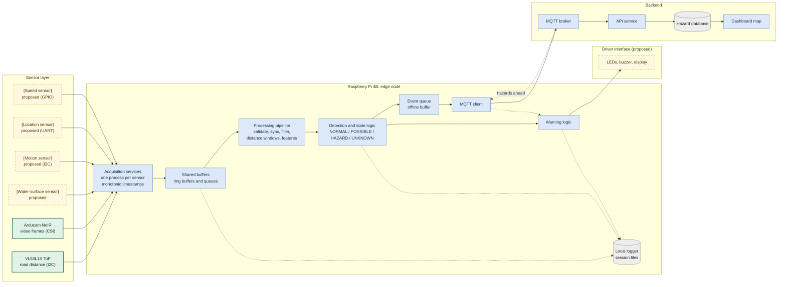

# RoadSight: Software Architecture and System Integration

| | |
|---|---|
| **Document** | `docs/software_architecture.md` |
| **Related** | `docs/data_architecture.md` (record formats), `docs/data_processing_and_detection.md` (pipeline and rules) |
| **Status** | Design stage (Stage 2). Nothing here has been run on real hardware. |

> **Conventions.** Parts are marked **Confirmed** (selected by the team) or **Proposed** (recommended, pending team confirmation and testing). Unselected sensors are named by role in square brackets, e.g. `[Water-surface sensor]`. Numeric values marked `[TBD]` are placeholders to be measured in Stage 3. This document replaces the earlier ESP32-based assumptions in `data_architecture.md`; the record formats there remain valid.

---

## 1. Purpose and scope

This document describes the software that runs on the vehicle node and the backend, how the pieces connect, and how integration will proceed from simulation to a vehicle. It does not define thresholds (see the detection document) or record formats (see the data architecture document).

RoadSight is an **advisory** system. The driver warning must keep working without any network connection.

---

## 2. Hardware status

| Part | Status | Role in the software |
|---|---|---|
| Raspberry Pi 4B | **Confirmed** | Edge compute node: acquisition, processing, detection, logging, uplink |
| VL53L1X ToF sensor | **Confirmed** | Candidate road-profile distance input. Behaviour under water is unproven |
| Arducam NoIR camera (model `[TBD]`) | **Confirmed** | Ground-truth video and flood context; not the primary detector in version 1 |
| `[Water-surface sensor]` | Proposed | Water presence and depth |
| `[Motion sensor]` (IMU) | Proposed | Vibration context and cross-check |
| `[Location sensor]` (GPS) | Proposed | Event location and time anchor |
| `[Speed / distance sensor]` | Proposed | Distance-based windows |
| `[Driver indicators]` (LEDs, buzzer, display) | Proposed | Warning output |

Because several sensors are not selected, all sensor access goes through a **hardware abstraction layer** (Section 7). Changing a sensor changes one driver, not the pipeline.

---

## 3. Architecture overview



**Legend:** solid green border = confirmed part; dashed amber border = proposed part; dotted arrows = logging and optional paths.

---

## 4. Layers and responsibilities

| Layer | Responsibility | Where it runs |
|---|---|---|
| Sensor layer | Produce raw measurements | Vehicle |
| Acquisition | Read each sensor, attach a monotonic timestamp and quality flags, publish samples to buffers | Pi (one process per sensor) |
| Processing | Validate, synchronise, filter, window by distance, extract features | Pi |
| Detection and state | Classify windows; stabilise with hysteresis; handle `UNKNOWN` | Pi |
| Warning | Map state to driver indication; always show a "system active" signal | Pi |
| Logging | Write raw and processed data and events for evaluation | Pi (local storage) |
| Uplink | Send hazard events and heartbeats; receive nearby hazards | Pi to broker |
| Backend | Store, cluster and serve hazards; dashboard | Server or laptop |

**Key design rule:** the path *sensor to driver warning* runs entirely on the Pi and does not depend on the network, the backend or the camera.

---

## 5. Interfaces between components

| Interface | Link | Data | Rate (target) | Failure signals |
|---|---|---|---|---|
| VL53L1X to Pi | I2C | distance, range status, signal rate, ambient rate (exact fields per ST driver) | `[TBD]` Hz (sensor maximum 50 Hz per ST) | status code not "valid", low signal, I2C error, timeout |
| Camera to Pi | CSI | frames with timestamps | `[TBD]` fps | dropped frames, over-exposure or glare, stalled capture |
| `[Water-surface sensor]` to Pi | `[TBD]` | distance to first reflecting surface | `[TBD]` Hz | no echo, out of range, spike |
| `[Motion sensor]` to Pi | I2C or SPI `[TBD]` | acceleration, angular rate | `[TBD]` Hz | bus error, saturation |
| `[Location sensor]` to Pi | UART or USB `[TBD]` | position, UTC time, fix quality | `[TBD]` Hz | no fix, high HDOP |
| `[Speed sensor]` to Pi | GPIO interrupts `[TBD]` | pulse counts | event-driven | no pulses while moving, implausible rate |
| Pi to driver indicators | GPIO `[TBD]` | state to indication | on change | output stuck |
| Pi to broker | MQTT over Wi-Fi or cellular | events and heartbeats | on event, heartbeat every `[TBD]` s | disconnect, backlog |
| Broker to Pi | MQTT subscribe | nearby confirmed hazards | on update | stale data |

---

## 6. Software on the Pi

### 6.1 Process model

Linux on the Pi is not a real-time system, so timing is handled by design:

- **One acquisition process per sensor**, each stamping samples with `CLOCK_MONOTONIC` (Python `time.monotonic_ns()`) as close to the read as possible.
- **Shared ring buffers or queues** (for example `multiprocessing` queues or shared memory) hand samples to the pipeline. Buffers are bounded; overflow is logged, never silent.
- **A pipeline and detection process** consumes aligned data.
- **A separate logger process** writes to disk so slow storage cannot stall detection.
- **A separate uplink process** handles MQTT so network problems cannot block warnings.

If measured timing jitter proves too large in Stage 3, the fallback is to move time-critical acquisition (ultrasonic echo timing, pulse counting) to a small microcontroller feeding the Pi over UART.

### 6.2 Time

- All ordering uses the monotonic timestamp.
- The Pi has no battery-backed clock. Wall-clock time is anchored to GPS UTC when a fix exists, or to network time when online; otherwise events are stored with a monotonic time and a "time unanchored" flag.

### 6.3 Supervision and power loss

- Each service runs under `systemd` with automatic restart.
- Each service publishes a heartbeat; a missing heartbeat sets the system status to `UNKNOWN`.
- The hardware watchdog `[TBD, to be evaluated]` resets a frozen Pi.
- Raw logs are written in small chunks and flushed regularly. The root filesystem is planned to be read-only or journaled, and a safe-shutdown mechanism is proposed, because sudden power loss can corrupt SD cards.

### 6.4 Resource budget

A CPU, memory and storage budget will be measured in Stage 3. Camera handling is the largest unknown; it is therefore decoupled from the warning path and run at a reduced rate `[TBD]` fps.

---

## 7. Hardware abstraction layer and integration contract

Every sensor implements the same interface, with a real driver and a mock driver.

```python
# Sketch only. Names and fields are placeholders.
class SensorDriver:
    name: str            # e.g. "road_profile"
    def start(self) -> None: ...
    def read(self) -> "Sample": ...      # blocking or timed read
    def stop(self) -> None: ...

class Sample:
    t_ns: int            # monotonic timestamp
    value: dict          # sensor-specific fields (see data_architecture.md)
    quality: int         # quality bitmask
```

- **Mock drivers** replay simulated or recorded data, so the whole pipeline can be built and tested before hardware exists.
- Real drivers are swapped in by configuration, not by editing the pipeline.
- Sample content and quality flags follow `docs/data_architecture.md`.

---

## 8. Data flows

| Flow | Path | Depends on network? |
|---|---|---|
| **Warning path** | Sensors, acquisition, pipeline, detection, warning, indicators | No |
| **Logging path** | Buffers, detection and warning events, local files | No |
| **Event path** | Detection, event queue, MQTT, broker, API, database, dashboard | Yes; queued offline |
| **Hazard-ahead path** | Database, broker, Pi, warning logic | Yes; optional enhancement |

Nearby hazards from other vehicles can raise awareness (for example, upgrade a `NORMAL` stretch to a `POSSIBLE` advisory), but local sensing always has priority, and the system works with this path disabled.

---

## 9. Timing and latency (design targets)

| Item | Target |
|---|---|
| Sensor reading to driver indication | `[TBD]` ms (to be measured end to end) |
| Detection window length | `[0.5]` m of travel |
| Event upload after detection | best effort, queued when offline |

The latency budget is split between acquisition, windowing (travel distance, not computation), detection and output. The **look-ahead distance** of the final sensor arrangement against vehicle speed limits the useful warning time; this is stated as a limitation, and the prototype speed envelope `[v_max]` is set accordingly.

---

## 10. Failure and degradation behaviour

| Failure | System response |
|---|---|
| Road-profile sensor invalid or stalled | Status `UNKNOWN`; local indication "detection unavailable" |
| Camera stalled | Warning path continues; log the fault; context unavailable |
| Water-surface sensor missing | Depth cannot be estimated; hazard class limited to `POSSIBLE` at most `[TBD]` |
| Location lost | Warnings continue; events marked unlocated and not published as hazards |
| Network lost | Warnings unaffected; events queue locally |
| Process crash | `systemd` restart; status `UNKNOWN` until healthy |
| Storage failure | Fault indicator; in-memory buffers keep the warning path alive |
| Power dip | Flush logs; controlled shutdown |

Detailed triggers and recovery rules are in the uncertainty-handling document.

---

## 11. Integration plan

| Stage | What is integrated | Environment | Exit criterion |
|---|---|---|---|
| **S0 (now)** | Pipeline, state machine, logger, uplink, backend, dashboard | Simulation with mock drivers | End-to-end run passes software tests (this is **not** a performance result) |
| **S1** | Each real sensor on its own | Bench | Driver produces timestamped samples with quality flags at the target rate |
| **S2** | All sensors together | Water-tray test rig | Time alignment verified; detector evaluated on labelled runs |
| **S3** | Full node on a moving rig or vehicle | Controlled outdoor or flooded stretch | Latency and false-alarm targets assessed |

Stage S0 can be demonstrated in the Stage 2 submission as software evidence. S1 to S3 belong to the Stage 3 plan.

---

## 12. Repository layout

```
roadsight/
  docs/                 design documents (this file, data_architecture, ...)
  sim/                  signal simulator and ASSUMPTIONS.md
  firmware/             sensor drivers and acquisition services (real and mock)
  pipeline/             validation, sync, filtering, windowing, features, detector
  backend/              MQTT consumer, API, database, clustering
  dashboard/            hazard map
  tests/                unit and integration tests
```

(The folder is named `firmware/` for consistency with the plan; on the Pi it contains Python acquisition services.)

---

## 13. Technology choices

| Choice | Reason | Alternative |
|---|---|---|
| Python 3 on the Pi | Fast to develop; libraries for I2C, camera, MQTT | C++ for time-critical parts if needed |
| MQTT (Mosquitto) | Lightweight, suited to intermittent links | HTTP for simple prototypes |
| FastAPI and SQLite | Simple and quick; migrates to PostgreSQL later | Flask |
| Leaflet map | Free and lightweight | Any web map library |
| `systemd` | Standard supervision on Raspberry Pi OS | Docker (adds overhead) |

Library names and versions will be confirmed during implementation.

---

## 14. Security and privacy

- MQTT over TLS with per-device credentials; credentials kept out of the repository.
- Device IDs are pseudonymous; trip start and end are trimmed before events are published.
- Location data is handled in line with applicable Indian data-protection requirements; to be reviewed before any public deployment.

---

## 15. Open items

| Item | Resolved by |
|---|---|
| Exact Arducam model and camera frame rate | Team confirmation |
| Selection of the water-surface, motion, location and speed sensors | Team decision and feasibility test |
| ToF behaviour over water and under a cover window | Tray test |
| Timing jitter on the Pi and need for a microcontroller | Bench measurement |
| CPU and memory budget | Stage 3 profiling |
| Power supply design and safe shutdown | Hardware team |
| Alert indicators and display | Team decision |

---

## 16. Changelog

| Date | Change |
|---|---|
| 2026-10-21 | First version: Raspberry Pi based architecture and integration plan |
